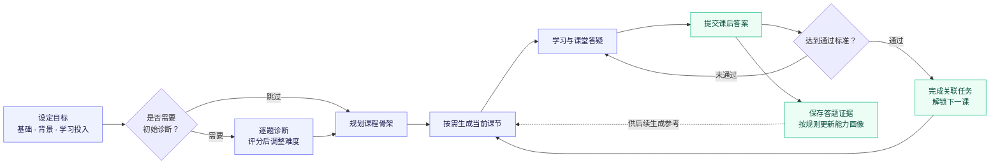
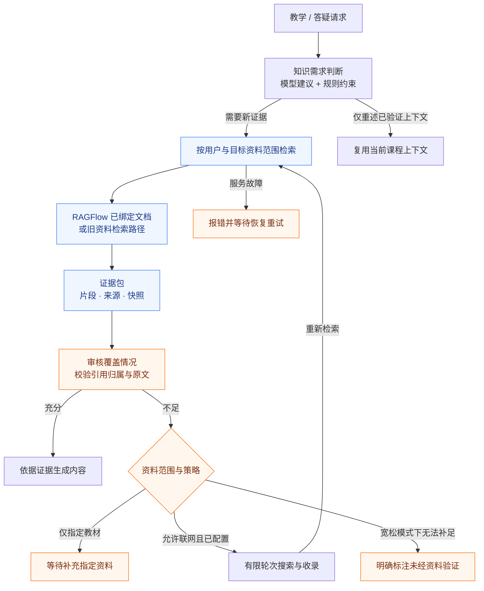
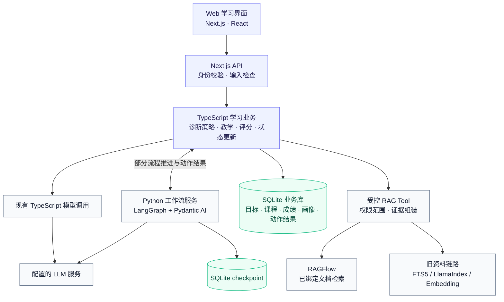

<div align="center">

# LearnStep

### 让每一次作答，成为下一步学习的依据。

面向个人目标的自适应学习助手，连接能力诊断、按需课程、资料答疑与考核反馈。

**TypeScript · Next.js · Python · LangGraph · Pydantic AI · SQLite · RAGFlow**

[快速开始](#快速开始) · [学习闭环](#学习闭环) · [技术设计](#技术设计) · [项目文档](#项目文档)

</div>

---

## 为什么做 LearnStep？

有了 AI，我们更容易得到一个答案、一份学习计划，却仍需要回答三个问题：

- **从哪里开始？** 自评和实际能力可能不一致。
- **这节课学会了吗？** 看完内容不等于能独立解决问题。
- **接下来学什么？** 固定计划难以利用后续答题反馈。

LearnStep 把这些问题串成一个持续的学习流程：先了解目标与基础，再生成当前需要的课程，通过考核收集证据，更新画像并推进后续学习。

> 当前为可运行原型。本文介绍已存在的功能与设计边界；历史验证范围见 [项目状态](docs/PROJECT_STATUS.md)。**最近更新 · 2026-10-12：** 重写项目介绍，新增学习闭环、资料证据链和系统架构图，见 [变更记录](CHANGELOG.md)。

## 学习闭环



*图中循环表示有后续课节时继续学习。解锁与正文生成分开处理；同题重答保存成绩，但不反复计入独立能力证据。*

### 一次典型使用

以“学习 Agent 工具调用与 ReAct”为例：

| 阶段 | 你做什么 | 系统做什么 |
| --- | --- | --- |
| 明确目标 | 填写目标、基础与学习投入 | 拆分能力，确定是否进入诊断 |
| 确认起点 | 回答诊断题 | 根据评分调整下一题难度与能力覆盖 |
| 开始学习 | 阅读当前课节、提出疑问 | 生成讲解、案例与练习，提供课堂答疑 |
| 验证理解 | 提交课后答案 | 按题目快照与评分标准给出反馈 |
| 推进计划 | 根据反馈复习或进入下一课 | 保存证据，更新状态，通过后完成任务并解锁下一课 |

这是使用流程示例，不是学习效果或准确率评测。

## 主要功能

| 功能 | 用户价值 | 实现要点 |
| --- | --- | --- |
| 自适应初始诊断 | 从更合适的位置开始 | 能力边界、逐题难度、题数与停止规则 |
| 按需课程生成 | 后续教学能利用已有反馈 | 课程骨架与课节正文分离，结合掌握度调整难度 |
| 课堂答疑与练习 | 在当前知识上下文中学习 | 教学块、练习和完成证据关联，题目结构检查 |
| 个人资料库 | 围绕自己的教材和资料学习 | 目标级资料选择、来源版本、检索与引用快照 |
| 学习进度联动 | 考核结果直接推进学习任务 | 成绩、画像、任务和课节状态的事务更新 |
| 中断与重试处理 | 减少重复操作和结果丢失 | 部分工作流 checkpoint、动作结果复用、评分请求幂等 |

## 技术设计

### 1. 模型负责语义判断，代码负责业务约束

LLM 负责生成题目、讲解和反馈，并判断回答质量及资料覆盖情况。业务代码负责用户权限、难度调整规则、通过阈值、课程版本和状态提交。

例如，自适应诊断不是简单地让模型“再出一道难题”：系统维护每项能力的通过/失败边界，再选择下一题的能力与难度。模型负责在这个约束下生成具体题目。

这套难度与掌握度策略目前属于启发式实现，尚未经过教育测量标定。

### 2. 检索到相关资料之后，还要检查能否支持教学



*图示为主干分支：严格模式下补充后仍不足会阻断；联网受配置及轮次预算限制，不是无限循环。*

课节审核以**原始课节目标**为依据，避免搜索词改写扩大教学要求。代码检查逐项覆盖结果、引用 ID 和逐字原文，语义支持关系仍需模型判断。指定教材不足时，不自动用其他教材替代。

当前已绑定文档可直连 RAGFlow；上传和联网入库仍保留旧链路。两条路径的边界见 [架构说明](docs/ARCHITECTURE_BOUNDARIES.md)。

### 3. 把一次评分变成可靠的业务操作

- **同一次请求重放**：携带 requestId 时，按用户、课节版本、题集和答案指纹复用结果；进行中返回等待状态。
- **失败后的接管**：租约和执行者标识约束超时恢复，旧执行者不能覆盖接管者的结果。
- **提交前再次校验**：评分期间课程或题目发生变化，拒绝把旧结果写入新版本。
- **事务内同步状态**：成绩、能力画像、关联任务与课节状态一起提交。
- **生成失败保留成绩**：下一课生成与已确认成绩分开处理，失败后可以重试生成。

不带 requestId 的旧调用不具有同等请求级幂等保证。LangGraph checkpoint 与业务事务各自承担不同职责，不能互相替代。

## 系统架构



*这是当前实现概览：TypeScript 与 Python 路径并存，尚未把所有教学与跨步骤逻辑迁入 LangGraph/Pydantic AI。*

| 技术 | 作用 |
| --- | --- |
| Next.js / React / TypeScript | 页面交互、API 与学习业务服务 |
| Python / LangGraph | 部分流程的状态、分支、中断与恢复 |
| Pydantic AI | 部分 Python 节点的模型调用与结构化输出 |
| SQLite | 业务数据、版本快照与动作记录；工作流另使用 checkpoint |
| RAGFlow | 已绑定资料的检索，由业务层控制授权范围 |
| MinerU / LlamaIndex / Embedding | 保留的资料解析、切块和编码路径，按部署配置启用 |

## 快速开始

### 先运行 Web 示例

需要 **Node.js 22.x 或 24.x** 和 npm。以下以 Windows PowerShell 为例：

```powershell
git clone https://github.com/1123688216/LearnStep.git
cd LearnStep
npm ci

# 仅首次创建，已有配置不覆盖
if (-not (Test-Path .env.local)) {
    Copy-Item -LiteralPath .env.example -Destination .env.local
}

npm run dev
```

打开 [http://127.0.0.1:3000/login](http://127.0.0.1:3000/login)，创建本地账号。

默认使用 `LLM_PROVIDER=demo`，可查看界面及示例交互。真实模型课程、评分和资料处理需要额外配置。默认业务数据库为 `data/learnstep.sqlite`，由应用初始化。

### 启用真实模型与资料服务

在本地 `.env.local` 中填写所需配置，真实密钥只留在本机或部署环境：

| 能力 | 需要准备 | 文档 |
| --- | --- | --- |
| 真实教学与评分 | LLM provider、endpoint、model、API Key | [配置参考](docs/REFERENCE_GUIDE.md#配置-llm) |
| 工作流恢复 | Python 环境、Workflow 服务及共享 token | [Workflow](services/workflow/README.md) |
| RAGFlow 检索 | Docker、模型配置、账号与文档绑定 | [RAGFlow](docs/RAGFLOW_DEPLOYMENT.md) |
| 旧上传与解析 | 入库服务，按文件类型配置 MinerU | [Ingestion](services/rag_ingestion/README.md) |
| 本地文本编码 | 模型文件、设备及服务地址 | [Embedding](services/embedding/README.md) |

仓库不包含真实密钥、用户数据库、模型权重或已绑定的数据集。

### Windows 全栈入口

依赖配置完成后，可使用根目录入口：

| 文件 | 用途 |
| --- | --- |
| `start-all.cmd` | 启动并检查完整本机服务，前端默认 3011 |
| `stop-all.cmd` | 停止本项目受管服务，保留数据 |
| `restart-frontend.cmd` | 只重启受管前端 |

这些入口负责服务启停，不代替模型和 Python 环境安装。单独 `npm run dev` 默认 3000，全栈入口默认 3011；不要同时运行端口冲突的两套服务。详细说明见 [脚本导航](scripts/README.md)。

## 验证与当前边界

**2026-09-29，在 LearnStep 目录验证：** TypeScript、ESLint、生产构建通过，Node 24 下 **21/21 隔离/模拟回归套件通过**。当前回归入口覆盖：

| 领域 | 覆盖示例 |
| --- | --- |
| 连续学习 | 三课生成、答疑、评分、画像与任务进度联动 |
| 一致性 | 评分请求重放、版本冲突、课程重生成失败 |
| 权限与资料 | 账号/目标隔离、范围过滤、不可变引用 |
| 异常恢复 | 模型及审核异常、下一课生成失败后成绩保留 |
| 内容展示 | 长题干、代码围栏、分区渲染与 HTML 转义 |

```powershell
npm run typecheck
npm run lint
npm run verify:learning
npm run build
```

上述结果是工程回归，不是准确率或教学效果指标。原项目另有真实模型功能验收记录，详见 [CHANGELOG](CHANGELOG.md)；本次 README 更新未重新调用模型或重跑业务测试。

当前重点边界：框架及 RAG 迁移尚未全部完成；普通宽松模式可能提供明确标注的非资料验证回答，指定教材要求保持严格；真人教学效果和生产并发容量尚未验证。

## 代码地图

```text
LearnStep/
├─ app/                  页面、课堂组件与 API
├─ lib/
│  ├─ agents/            规划、教学、考核与模型调用
│  ├─ learning-loop/     自适应诊断、课程生成与后续学习
│  ├─ learning-program/  内容契约、质量检查与答题草稿
│  ├─ knowledge/         检索、证据审核与联网工具
│  ├─ workflow/          Python 工作流业务桥接
│  └─ db/                事务、版本、画像与请求幂等
├─ services/             workflow / rag_ingestion / embedding
├─ deploy/ragflow/       Docker 部署配置
├─ scripts/              回归、运维与维护脚本
├─ docs/                 架构、配置与历史设计
└─ android/              保留的 Capacitor Android 工程
```

## 项目文档

[项目导航](docs/README.md) · [当前状态](docs/PROJECT_STATUS.md) · [架构边界](docs/ARCHITECTURE_BOUNDARIES.md) · [Agent 角色](docs/AGENT_ROLES.md) · [脚本导航](scripts/README.md) · [历史变更](CHANGELOG.md)

开发前阅读 [AGENTS.md](AGENTS.md)。LearnStep 从 Growth Loop 工作区整理而来，来源、兼容标识与授权说明见 [UPSTREAM](UPSTREAM.md)；目前未添加新的开源许可证。
